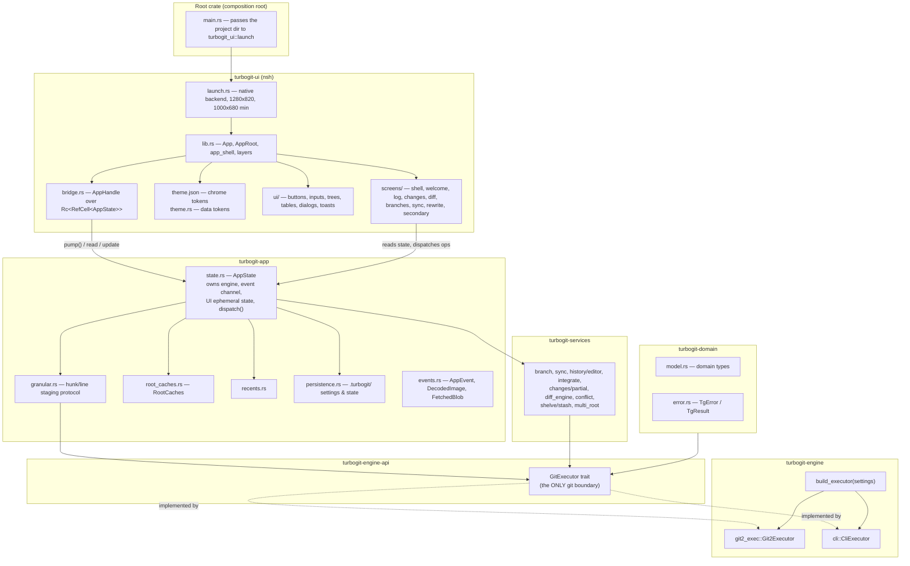
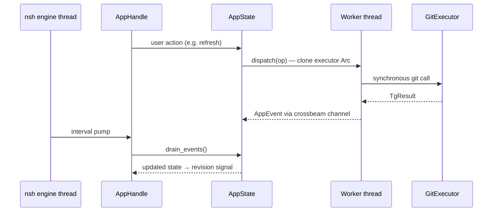

# TurboGit architecture

TurboGit is a desktop Git client whose presentation layer is Native Shell (nsh)
0.5.x: one Rust app rendered with each desktop's native controls (AppKit,
Win32/Direct2D, GTK 4). It is split into one Cargo crate per layer and keeps a
strict separation: the **UI layer never calls git directly**, all git work goes
through an engine seam (`GitExecutor`) executed on worker threads, with results
delivered back to the app over a channel.

## Workspace layout

| Crate | Responsibility | Depends on |
|---|---|---|
| `turbogit-domain` | `model` + `error`; the leaf | `serde`, `chrono`, `thiserror` |
| `turbogit-engine-api` | the `GitExecutor` port, `ApplyDirection`, and the port's two value modules (`patch`, `repo_state`) | domain |
| `turbogit-engine` | the adapters, the factory, the fake | domain, engine-api, `git2` |
| `turbogit-services` | pure domain services over the port | domain, engine-api |
| `turbogit-app` | `AppState`, worker dispatch, events, caches, persistence, granular | domain, engine-api, engine, services |
| `turbogit-ui` | the nsh presentation crate: `src/ui/` controls, `src/screens/` surfaces, `theme.json`, `src/theme.rs`, the bridge, and `launch` | app, domain, nsh-core, nsh-base, the platform backends |
| `test-support` | the nsh harness (`nsh` feature), git fixtures, source scans | domain, engine-api (+ `nsh` feature) |
| `turbogit` (root) | `main.rs`, the composition root | `turbogit-ui` |

Dependencies flow strictly downward:

```
domain ← engine-api ← {engine, services} ← app ← ui ← root
```

The root package carries no domain code. `src/main.rs` parses an optional
project directory and calls `turbogit_ui::launch::launch`; nothing in the root
manifest depends on a platform backend.

## High-level diagram



### One sanctioned impurity

`AppState` constructs its own engine: `launch_in` and `for_roots` both go
through `with_flat_state` (`turbogit-app/src/state.rs`), which reaches
`turbogit_engine::build_executor`, as does `rebuild_executor`.
`turbogit_engine::resolve_git_version` is read at the same sites and re-exported
from the app's `lib.rs`. So `turbogit-app → turbogit-engine` is two real edges
rather than the clean `app → port` flow the rest of the graph follows; the
app's patch parsing is not one of them, because that reader lives in
`turbogit-engine-api` (ADR-0022).

The textbook fix is injecting `Arc<dyn GitExecutor>` from the composition root.
It would instead change constructor signatures used by many test call sites, and
nothing needs it today: a test that wants another executor swaps one in after
construction through `AppState::with_executor`. These two edges are accepted and
treated as the whole impurity, the only places an app-side call may reach the
adapters.

**Deferred options (do not schedule):** executor injection into `AppState`;
splitting `GitExecutor` into capability traits; decomposing UI state out of
`AppState`.

## Layer responsibilities

### 1. Entry (root: `src/main.rs`)

- Parses an optional project directory from the command line.
- Calls `turbogit_ui::launch::launch`, which mounts the `AppRoot` component on
  the native backend with `theme.json` and the dark appearance, at 1280x820
  with a 1000x680 minimum content size.
- Launch flow (ADR-0004): `Some(dir)` enters the shell directly; `None` lands on
  Welcome. `TURBOGIT_CONFIG` points the recents store at a scratch directory.

### 2. UI (`turbogit-ui`)

- `src/lib.rs` owns the `App` component (what `nsh run` and `nsh package` mount),
  the harness-mountable `AppRoot`, the app shell, and the layered dialogs,
  banners, toasts, and overlays.
- `src/bridge.rs` owns `AppHandle`: one `Rc<RefCell<AppState>>` plus a revision
  `Signal`. `read` and `update` keep borrows short; `pump` drains events and
  ticks the poll cadence from one interval.
- `src/screens/` owns one screen per surface and the route table. A screen
  renders inside the shell; dialogs are painted by the shell from the state that
  says they are open.
- `src/ui/` owns the general controls. A general control takes no application
  state and decides no policy.
- Reads from `AppState`; never calls git directly.
- The token layers are `theme.json` (chrome) and `src/theme.rs` (data roles).
  `docs/design-system-roles.md` records which name owns which role.

### 3. State & App Services (`turbogit-app`)

- `state.rs`, `AppState` is the hub: owns the `Arc<dyn GitExecutor>`, the
  multi-root model, canonical settings, the crossbeam event channel, and all
  UI-only ephemeral state. Git work is dispatched as an `Operation` via
  `AppState::dispatch`, which runs it on a worker thread (`Spawned`) under the
  shell or inline (`Inline`) under the headless harness; either way it answers
  through the same channel, and the pump (`drain_events`) is on `AppState`.
  Settlement matches the operation's `OpKind`, never its label text (ADR-0020).
- `granular.rs`, the stateful staging protocol.
- `events.rs`, the transport from worker threads back to the app.
- `root_caches.rs`, per-root caches invalidated by `Affected` op-scope.
- `persistence.rs`, serializes settings/state under `.turbogit/`.
- `recents.rs`, the global recent-projects file (ADR-0005).

### 4. Services (`turbogit-services`)

Pure-ish services over the engine seam; no UI types, no `AppState`:

| Module | Responsibility |
|---|---|
| `branch_service` | branch create/rename/delete/checkout flows |
| `sync_service` | fetch/pull/push orchestration |
| `history_service` / `history_editor` | log queries; interactive rebase plans |
| `integrate_service` | merge / rebase / cherry-pick incl. abort/continue |
| `changes` / `partial` | staging, selected-file and hunk-level commits |
| `diff_engine` | diff computation/normalization |
| `conflict` | conflict detection & resolution state |
| `shelve_stash` | stash/shelve operations |
| `multi_root` | root discovery and multi-repo scanning |

### 5. Engine

- **`turbogit-engine-api`**, `GitExecutor` is the **only** thing that talks to
  git, plus `ApplyDirection` and the port's value modules (`patch`,
  `repo_state`). Every method is synchronous, so callers run them on worker
  threads and the UI never blocks.
- **`turbogit-engine`**, the adapters and the factory:
  - `cli::CliExecutor`, shells out to system `git`; handles **all mutating ops**.
  - `git2_exec::Git2Executor`, in-process libgit2 for supported reads, falling
    back to the CLI for sync/credential ops, reverse patch apply, intent-to-add,
    and diffs libgit2 can't express. `build_executor(settings)` builds the
    composed pair and nothing else (ADR-0030).
  - `fake::FakeExecutor`, test double, exported only behind the `test-util`
    feature.

### 6. Domain (`turbogit-domain`)

- `model.rs`, domain types. Every mutable git state is scoped to a `Root`.
- `error.rs`, `TgError` / `TgResult` used across all layers.

## Threading model



`AppState` stays single-threaded on the nsh engine thread behind
`Rc<RefCell<_>>`; the revision signal tells nsh what changed.

## Key architectural decisions

| ADR | Decision |
|---|---|
| ADR-0001 | Engine seam: `GitExecutor` trait; libgit2 vs CLI selectable by settings |
| ADR-0003 | Dark-only theme tokens |
| ADR-0004 | Launch flow: dir → shell, none → Welcome |
| ADR-0005 | Global recent-projects config |
| ADR-0014 | Diff rendering virtualizes over a display-row model |
| ADR-0016 | Mockups are the single source of truth for the UI redesign |
| ADR-0020 | `Operation` is the dispatch unit; label text is display-only |
| ADR-0021 | The keyed read is a surface's only way to reach cached git data |
| ADR-0022 | The Git engine answers with domain values, over one honest adapter |
| ADR-0028 | Conventional commits through one cocogitto parser |
| ADR-0030 | One engine; the backend choice is retired |
| ADR-0035 | The presentation layer moves to Native Shell (nsh) |
| ADR-0036 | egui is removed; nsh is the one UI and one release path |

## Testing architecture

Tests live in the crate they exercise, and span crates only when they must:

- `crates/turbogit-engine/tests/`, engine-level behavior against real repos.
- `crates/turbogit-services/tests/`, service behavior over the fake executor.
- `crates/turbogit-app/tests/`, stateful staging and cache invalidation.
- `crates/turbogit-ui/tests/`, the nsh behavior suites, the accessibility and
  token audits, the ignored perf harnesses, the `tests/ui/*.test.tsx` screenshot
  lanes, and `diff_parity.rs`.
- root `tests/`, the two suites that need every crate:
  - `patch_value.rs`, pins ADR-0022's patch-value conventions.
  - `port_discipline.rs`, pins ADR-0022's one-raw-escape rule.

Behavior suites mount `TestRoot` or `AppRoot` in `nsh_testing::Headless` at
1280x820 dark on a manual clock through `test_support::nsh_harness`. Visual
claims come from `nsh test --target macos` screenshots, not from `cargo test`.
Shared helpers (`RecordingExecutor`, the git recipes, the source scans) live in
`test-support`; its `nsh` feature carries only the headless harness.

The release path is one command per desktop: `nsh package --target
{macos,windows,linux}` from `crates/turbogit-ui`. macOS produces a `.app` (zipped
for the release asset), Windows a `.zip`, and Linux the native tarball on Ubuntu
24.04 (GTK 4.14, glibc 2.39).
